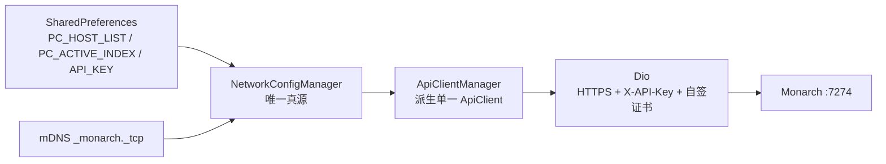

# Torrid Android 架构

## 1. 分层

Torrid 是 Flutter Android-only 应用，入口在 [main.dart](../../android/lib/main.dart)：

```text
main
  ├─ WidgetsFlutterBinding / 竖屏锁定
  └─ ProviderScope(MyApp)
       ├─ MaterialApp.router
       └─ GoRouter -> features/*/pages
```

目录职责：

| 目录 | 职责 |
| --- | --- |
| `app/` | 应用主题、路由、壳 |
| `core/` | 网络、证书、mDNS、Drift/Prefs、通用模型/组件 |
| `providers/` | Riverpod 级别的网络配置、ApiClient、存储/进度派生 |
| `features/` | 按功能拆分的页面、provider、service、model、widget |

Riverpod 负责依赖、查询和业务动作。Gallery 浏览设置与下载筛选分组持久化，下载使用启动时读取的筛选快照，组内浏览位置只保留在当前会话。根作用域关闭 provider 自动重试，页面失去可见性时由 Riverpod 暂停订阅，写入和同步通过业务动作管理生命周期。

顶层 GoRouter 路由见 [routes.dart](../../android/lib/app/routes/routes.dart)。`/others` 下的漫画、画廊、相册和智能相册是页面内 `Navigator.push` 的二级功能，不要误以为它们都是顶层深链路。

首页点击背景展开左侧菜单，保留背景、侧栏与座右铭配置；首页自身处理返回键，先关闭菜单，再应用双击退出。媒体入口使用共享 Material 卡片，支持大字体单列布局。

## 2. 网络真源与请求链



- [NetworkConfigManager](../../android/lib/providers/network_config/network_config_provider.dart) 负责多主机、激活项、API key 和 mDNS 发现结果。
- [ApiClientManager](../../android/lib/providers/api_client/api_client_provider.dart) 监听网络配置派生 `ApiClient`；不要在页面中手动推送 ApiClient。
- [ApiClient](../../android/lib/core/services/network/api_client.dart) 统一 Dio、证书、header、GET 重试、二进制和 NDJSON 流。
- 启动页初始化证书与本地存储，失败可重试且不清数据。公共 HTTPS 使用系统 CA，Dart 与 Android 原生播放器共用 `res/raw/server.crt`，仅匹配内置证书时允许主机名不匹配。切换网络配置时关闭旧 ApiClient，页面读请求随 provider 释放取消。
- 网络错误通过 `ApiClient.mapError` 转为可读信息，业务请求由各功能的 service/provider 处理。

服务端 mDNS 只广播 HTTPS 端口；发现后端上保存的 host/port 不会自动切换激活项。

## 3. 本地持久化策略

| 存储 | 内容 | 权威关系 |
| --- | --- | --- |
| SharedPreferencesWithCache | 主机配置、API key、对话选项、外观与 Gallery 显示/下载设置 | 本地设置，个性化可单独同步 |
| Drift `torrid.sqlite` | 随笔、标签、打卡、tombstone 与 revision 游标 | 双端可写，Monarch 可重新下发已同步的数据 |
| Drift `torrid.sqlite` | Gallery 工作副本、图库 ID、浏览位置、待回传操作 | 服务端权威，未确认的编辑保存在本机 |
| Drift `torrid.sqlite` | 随笔草稿、对话、回顾历史、漫画阅读进度及下载队列 | 本机独有 |
| Drift `torrid.sqlite` | Review 预设、漫画/章节元数据 | Review 镜像以服务端为准；漫画索引可从离线文件重建 |
| 内部 Application Support `media/` | 打卡/随笔/聊天附件、草稿、个性化图片 | 持久用户文件，不属于缓存 |
| 外部应用私有 `comics/`、`gallery/` | 漫画和画廊离线媒体，画廊预览按图库 ID 分目录 | 按模块清理，不随普通清缓存删除 |
| 系统缓存 `media_share/`、`media_export/` | 分享和导出暂存 | 与网络图片缓存分开统计；保留近 24 小时分享文件 |

[AppDatabase](../../android/lib/core/services/storage/app_database.dart) 持有一套后台 SQLite 连接。表定义和访问代码随功能拆分；随笔标签关联有独立表，随笔汇总、标签计数、打卡统计及 Gallery 处理范围按当前数据计算。随笔/打卡先上传后拉取，附件就绪后事务合并数据、删除标记和对应主机的游标。留言随正文版本同步，改标签只推进 `labels_updated_at`。

文件操作统一经过 [IoService](../../android/lib/core/services/io/io_service.dart)：用户文件、离线文件和临时文件边界分开，导入使用唯一文件名与同盘暂存后重命名。`img_storage/booklet|essay|chat/...` 等同步键仍与后端兼容，映射到内部 `media/booklet|essay|chat/...`；不保存绝对用户图片路径。旧外部附件目录不自动迁移，重装后从后端恢复打卡、随笔与偏好；草稿、聊天和回顾仅存本机，卸载会丢失。

公共导出走 Android MediaStore：图片进入 `Pictures/torrid/`，视频进入 `Movies/torrid/`，不覆盖同名文件。Android 10+ 无需存储权限；更早版本仅请求普通存储权限。画廊/视频先流式下载到隔离暂存文件，退出页面取消下载；后台仅执行当前导出操作，不新增常驻服务。

可丢弃的网络图片由 `cached_network_image` 使用 `DefaultCacheManager` 缓存，图库预览、漫画下载、用户附件和导出文件按各自生命周期管理。阅读和画廊共用 [MediaVideoPlayer](../../android/lib/core/widgets/media/media_video_player.dart)。阅读视频自动循环，全屏沿用当前控制器。画廊原片走带鉴权的网络流，本地预览用于加载占位。隐藏或进入后台时暂停，切换来源或退出时释放播放器。

## 4. 功能域与后端映射

| 功能 | 主要目录 | API / 数据策略 |
| --- | --- | --- |
| 积微 | `features/booklet` | `/API/user-data/*`；按 updated_at 增量合并，删除保留 tombstone |
| 随笔 | `features/essay` | `/API/user-data/*`；本地派生统计从实际数据重算 |
| 对话 | `features/chat` | `/API/ai/chat` NDJSON；会话和消息在本机 SQLite |
| 近期回顾 | `features/chat` | 后端计算统计，端上消费 `stats -> delta`；结果只存本机 |
| 漫画 | `features/others/comic` | `/API/comic/*`；服务端库 + 端上阅读/下载缓存 |
| Gallery | `features/others/gallery` | `/API/gallery/*`；离线编辑，批次回传校验 |
| Immich 相册 | `features/others/immich` | 在线直达服务端写入，不复用 Gallery 离线缓冲 |
| 智能相册/AI | `features/others/smart_album`、`ai` | `/API/ai/*`；503 时隐藏可选 AI 块或给明确提示 |
| 阅读/RSS | `features/read` | 独立第三方接口，不依赖 Monarch 主数据 |

## 5. 两种容易混淆的写路径

### Gallery 画廊

页面动作进入 `MediaAssetList` 的统一操作入口，执行：

```text
操作与本地工作副本同事务落盘
  -> gallery_write_buffer 按序回传 PATCH/标签 API
  -> 失败保留，有限次后台重试
  -> 标记已处理时补传并逐项校验，成功后清理
```

不要在页面中手写 `updateMediaAsset + queuePatch`，否则容易漏掉内存态同步。

### Immich 相册

该页按在线模型走 `retryServerWrite`。Gallery 第一次连接时绑定服务端图库 ID，同一图库的不同地址可共用工作副本。更换图库前需先确认已有操作，再在画廊设置中清空工作副本。

## 6. Chat / Review 流式边界

[chat_api_service.dart](../../android/lib/features/chat/services/chat_api_service.dart) 负责逐行拆 NDJSON，`/chat` 与 `/review` 共用解析器：

- `notice`：SnackBar/提示。
- `thinking`：可选思考状态。
- `stats`：Review 的确定性统计。
- `delta`：正文增量。
- `done`：本轮完成。
- `aborted`：模型仲裁抢占，显示“已中断/继续”，不当成普通错误。
- `error`：明确错误。

图片附件采用两条路径：库内媒体只传 `media_id`；手机照片压缩后拷入 `img_storage/chat/`，再以 base64 内联。删除会话必须同时清理附件文件。

## 7. 修改端上接口时的顺序

1. 查看 [API 路由快照](../../backend/references/generated/api/routes.md)，按 handler 定位真实响应。
2. 更新对应 `features/*/services`、model 和 provider。
3. 对 503、空列表、字段缺失、流中断做降级。
4. 如果涉及 Gallery 写入，确认服务端权威和缓存更新顺序没有反转。
5. 在根目录运行 `pwsh -File verify.ps1 -Scope android`。
